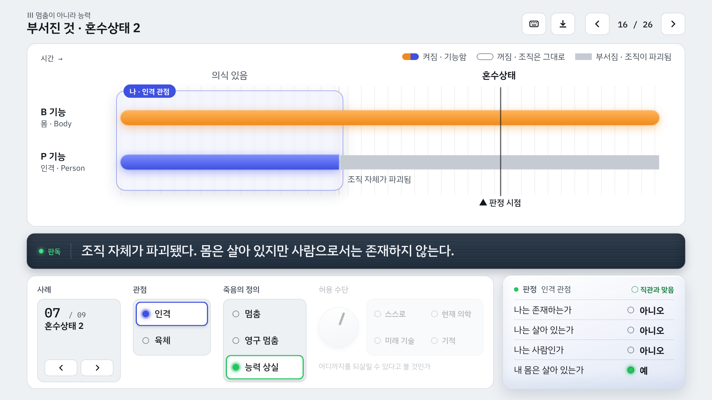

# 꺼진 것과 부서진 것

셸리 케이건 『죽음이란 무엇인가』 7장 「죽음의 본질에 관하여」를 발제하려고 만든 웹 발표 자료. 2026년 2학기 교양 수업 「삶과 죽음의 철학」에서 11월 26일에 두 명이 함께 발표했고, 이 웹 자료는 임낙원이 만들었다.

## 무엇을 만들었나

7장은 "언제 죽었다고 할 수 있는가"를 사례 하나하나에 죽음의 정의를 대 보며 따진다. 슬라이드를 넘기며 결론만 보여 주는 대신, 사례·관점·정의를 바꾸면 판정이 어떻게 달라지는지 청중이 직접 보게 하는 데 초점을 뒀다.

- **한 화면 문법**: 26쪽 모두 같은 틀(사례를 보여 주는 화면, 한 줄 해설, 조작부)을 쓴다. 쪽이 바뀌어도 어디를 봐야 할지 흔들리지 않는다
- **판정 조작부**: 사례, 관점(인격·육체), 죽음의 정의(멈춤·영구 멈춤·능력 상실), 허용 수단을 고르면 "나는 존재하는가", "살아 있는가" 같은 판정과 시간축 그림이 바로 바뀐다
- **실시간 투표**: 청중이 QR로 접속해 19쪽에서 사이먼 사례에 투표했다. 하나를 고르기 전에는 결과를 숨겨 앞선 표에 휩쓸리지 않게 했고, 휴대폰 세로 화면에서는 투표용 레이아웃으로 바뀐다. 38명이 참여했다
- **강의실 조건에 맞춘 화면**: 빔프로젝터가 어두워 밝은 화면을 기본으로 하고, 1280×720 무대를 창 크기에 맞춰 키운다. 발표는 키보드로 순서대로 넘긴다
- **가져가기**: 같은 페이지에서 PDF와 HTML 파일을 받을 수 있다. PDF는 인쇄 모드에서 26쪽을 그대로 렌더해 만든다

## 구성

- `index.html` 발표 화면 전체(HTML·CSS·JS 한 파일, 빌드 없음). 오른쪽 위 키보드 버튼이나 `?`로 단축키 목록을 연다
- `vote.html` 발표 때 QR로 나눠 준 주소(`/vote`)를 19쪽(`/#19`)으로 넘긴다
- `deck.pdf` 26쪽 PDF
- `DESIGN.md` 색·서체·배치 값과, 고칠 때 지켜야 할 디자인 원칙(Visual Contract)
- `vercel.json` 깔끔한 주소, 폰트 캐시, PDF 파일 이름
- `supabase/schema.sql` 투표에 쓴 테이블과 함수
- `docs/preview.png` README 미리보기 이미지
- `fonts/` IBM Plex Sans KR, IBM Plex Mono (SIL Open Font License)

## 투표는 어떻게 돌아갔나

발표 당일에는 Supabase의 데이터베이스 함수(RPC)로 표를 받았다. 테이블은 RLS를 켜고 정책을 하나도 두지 않아 브라우저가 직접 읽거나 쓸 수 없었고, 공개용 키로는 함수 세 개만 부를 수 있었다. 표는 기기마다 하나, 바꾸기는 3초 간격으로 제한했고, 초기화는 해시로 저장한 PIN을 서버에서 확인해야만 됐다. 정의는 [`supabase/schema.sql`](supabase/schema.sql)에 있다.

발표가 끝난 뒤 집계 서버를 멈추고, 그날 결과(죽어 있었다 14, 살아 있었다 20, 둘 다 아니다 4)를 `index.html`의 `RESULT`에 고정했다. 지금 19쪽은 이 결과를 보여 준다.
